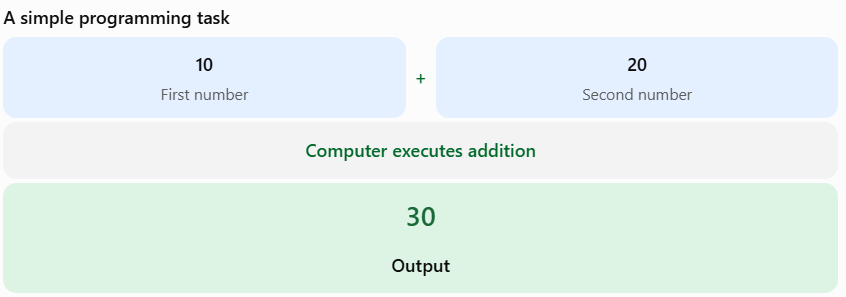

# Q: **What is programming, and how do Java programs execute?**

A: Programming is the process of writing instructions that tell a computer what to do, how to do it, and in what order.

For example, suppose you want a computer to add two numbers.

As a human, we can understand this immediately:
Take 10, add 20, and show me the result.

But the computer needs instructions written in a language and format it can process

To make this happen, we write a program.

`int a = 10;
int b = 20;
int sum = a + b;

System.out.println(sum);
`

This program instructs the computer to:
1. Store the number 10
2. Store the number 20
3. Add both numbers
4. Display the result 30 

Programming isn't just writing code. It's breaking a problem into clear instructions a computer can execute.

programming language? 
We communicate with each other using languages like English, Telugu, or Hindi.
Computers, however, execute instructions using machine-level representations (binary patterns of 0s and 1s).

Writing instructions directly in binary would be extremely difficult for humans. So programming languages were created to make instructions easier to write and understand.

Examples:
Language	Common use
Java	    Enterprise applications, backend systems
C	        Operating systems, embedded systems
C++	        Game engines, high-performance software
Python	    Automation, AI, scripting, data science
JavaScript	Web development
C#	.NET    applications, game development

A programming language provides rules for writing instructions. Those rules are called syntax.
For example, in Java:
int age = 25; //This is a valid Java statement
But:
int = age 25; //This is invalid because it doesn't follow java's syntax rules