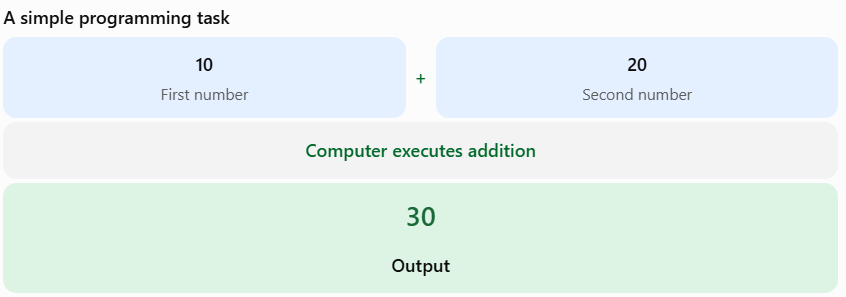
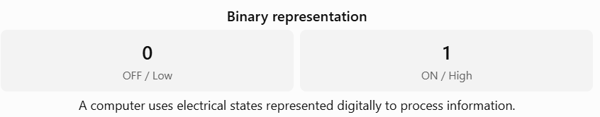
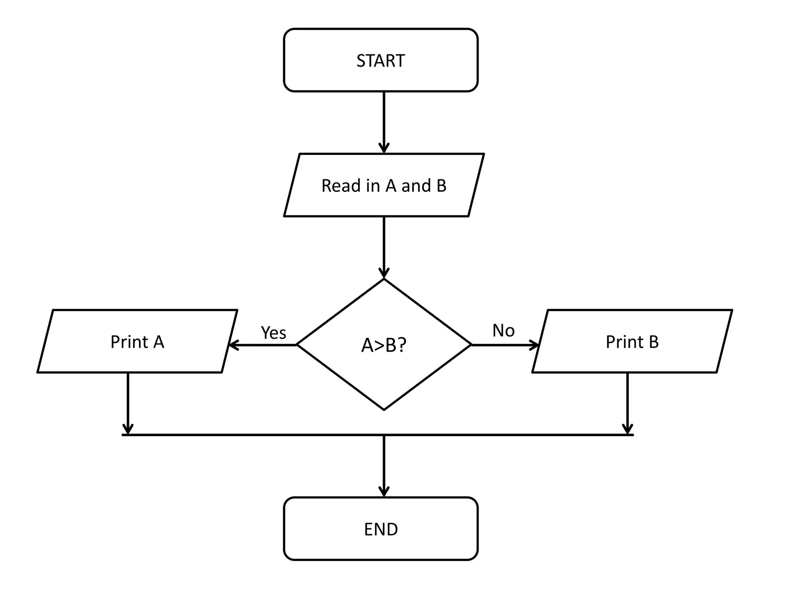
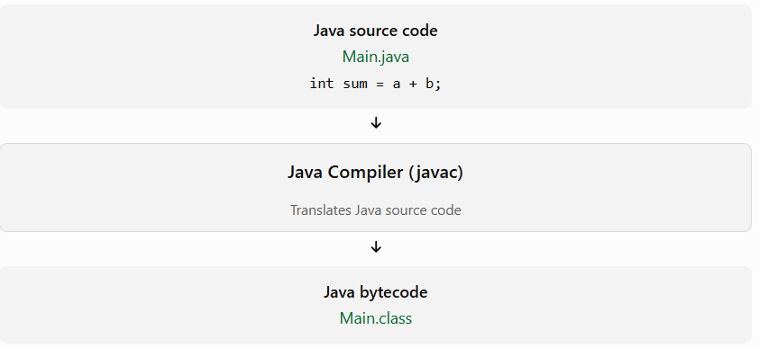
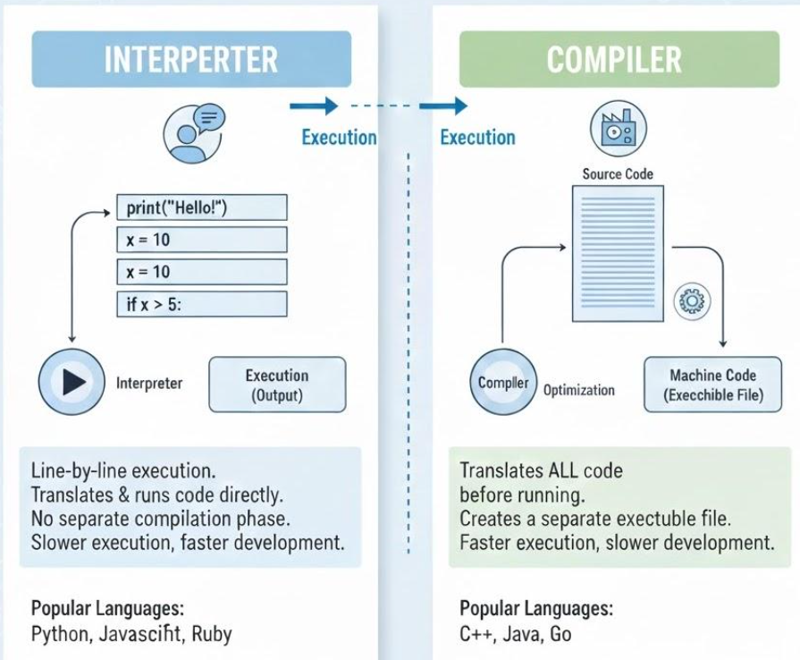
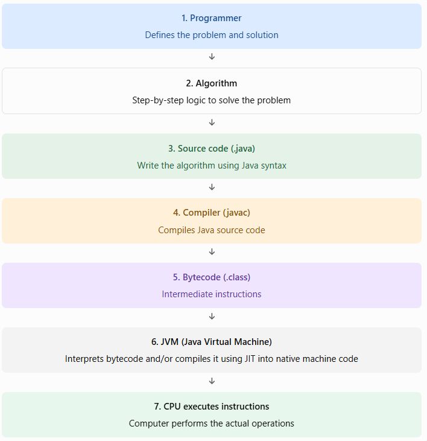

# Q: **What is programming is, source code, machine code, algorithms, interpreter?**

A: Programming is the process of writing instructions that tell a computer what to do, how to do it, and in what order.

For example, suppose you want a computer to add two numbers.

As a human, we can understand this immediately:
Take 10, add 20, and show me the result.

But the computer needs instructions written in a language and format it can process


To make this happen, we write a program also called source code.

Source code is the set of instructions written by a programmer using a programming language that humans can read and understand.

```java
int a = 10;

int b = 20;

int sum = a + b;

System.out.println(sum);
```

This program instructs the computer to:
1. Store the number 10
2. Store the number 20
3. Add both numbers
4. Display the result 30 

Programming isn't just writing code. It's breaking a problem into clear instructions a computer can execute.

programming language? 
We communicate with each other using languages like English, Telugu, or Hindi.
Computers, however, execute instructions using machine-level representations (binary patterns of 0s and 1s).

Writing instructions directly in binary would be extremely difficult for humans. So programming languages were created to make instructions easier to write and understand.

Examples:

| Programming Language | Common Applications |
|----------------------|---------------------|
| Java | Enterprise applications, backend systems |
| C | Operating systems, embedded systems |
| C++ | Game engines, high-performance software |
| Python | Automation, AI, scripting, data science |
| JavaScript | Web development |
| C# (.NET) | Enterprise applications, desktop applications, game development |

A programming language provides rules for writing instructions. Those rules are called syntax.

For example, in Java:
int age = 25; //This is a valid Java statement

But int = age 25; //This is invalid because it doesn't follow java's syntax rules

#### What is machine code?

computer's CPU (Central Processing Unit) ultimately executes instructions represented in a form understood by its hardware.

Machine code is the low-level instruction representation that a processor can execute directly.

At a fundamental level, computers work with binary digits and they are called bits:
- 0
- 1




#### What is an algorithm?

An algorithm is a step-by-step procedure to solve a particular problem.

Before writing code, we should understand what problem we are solving and decide the steps to solve it.

Real-life example: Making Pav bhaji

Our algorithm could be:
1. Collect all the ingredients (potatoes, tomatoes, onions, capsicum, green peas, Pav Bhaji masala, butter and pav).
2. Wash and chop the vegetables.
3. Boil the potatoes and green peas until they become soft.
4. Heat butter in a pan.
5. Add chopped onions and fry until they become golden brown.
6. Add tomatoes and capsicum.
7. Add salt and Pav Bhaji masala.
8. Cook until the vegetables become soft.
9. Add the boiled potatoes and green peas.
10. Mash all the vegetables together.
11. Add water as required and cook until the bhaji reaches the desired consistency.
12. Cut the pav into halves.
13. Heat a pan and add butter.
14. Toast the pav on both sides.
15. Transfer the bhaji to a serving plate.
16. Garnish with butter, chopped coriander and lemon.
17. Serve hot Pav Bhaji with toasted pav.


Programming example: Find the bigger of two numbers

Problem: Given two numbers, find the greater number.

Algorithm
1. Start.
2. Take two numbers, A and B.
3. Compare A with B.
4. If A is greater than B, display A.
5. Otherwise, if B is greater than A, display B.
6. If both are equal, display that both are equal.
7. Stop.



Now let's implement this algorithm in Java:

```java
public class Main {
public static void main(String[] args) {
int a = 10;
int b = 20;

        if (a > b) {
            System.out.println(a);
        } else if (b > a) {
            System.out.println(b);
        } else {
            System.out.println("Both are equal");
        }
    }
}
```

(We learned algorithm and pav bhaji 😁😁)

#### What is a compiler?
A compiler is a software program that translates source code written in a programming language into another form that can be executed or further processed.

It checks the source code according to language rules and performs translation.

The Java compiler is called javac

When we compile: javac Main.java


It produces: Main.class

This .class file contains Java bytecode, not the original Java source code and not native machine code for a specific CPU.


What is bytecode?

Bytecode is an intermediate instruction format produced by the Java compiler.

It is designed to be executed by the Java Virtual Machine (JVM).

This is one of the major reasons Java is portable across operating systems and processor architectures that have compatible JVM implementations.

#### What is an interpreter?

An interpreter is a program that executes instructions by interpreting them, rather than requiring the entire program to be translated into native machine code ahead of execution.

A simplified way to understand it:

Imagine a person who speaks only Telugu and another person who speaks only English.

A translator stands between them and translates what is said so each can understand.

Similarly, an interpreter reads instructions in a form it understands and helps execute them.



### How all these concepts connect in Java
When you write a Java program and run it, the process looks like this:



Java execution in simple terms
1. We identify a problem
2. We design an algorithm to solve it
3. We write Java source code
4. javac compiles source code
5. Bytecode is generated in .class files
6. JVM loads and executes bytecode, using interpretation and JIT compilation
7. The CPU executes native machine instructions
